<p align="center">
  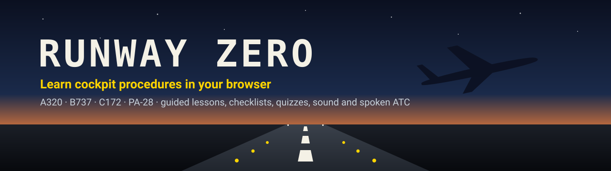
</p>

<p align="center">
  <a href="https://www.runwayzero.in/"><b>▶ Try it now in your browser</b></a>
  &nbsp;·&nbsp; free &nbsp;·&nbsp; nothing to install &nbsp;·&nbsp; no account
</p>

<p align="center">
  
  
  
  
</p>

**Runway Zero** teaches you how to work a real cockpit, one switch at a time. Bring an airliner to life from cold and dark, set up the flight computer for Delhi to Mumbai, start the engines, talk to ATC and fly the autopilot. Or start a light aircraft and handle a failure. A guide tells you what to do and why, the right switch pulses yellow, and each step ticks off only when the aircraft is really set that way.

<p align="center">
  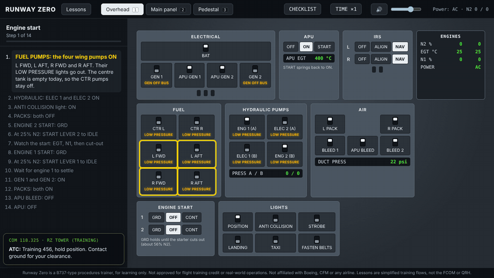
  <br><sub>A B737 engine start: fuel pumps, hydraulics, packs off, start switch to GRD, start lever to IDLE at 25% N2.</sub>
</p>

> [!IMPORTANT]
> For learning only. Not approved for flight training credit or real-world operations. Not affiliated with or endorsed by Airbus, Boeing, Cessna, Textron, Piper, Garmin, CFM or any airline. Lessons and checklists are simplified training flows written in our own words, not operator or manufacturer procedures.

## Highlights

- 🛫 **Four aircraft**: an A320neo-type and a B737-type airliner, and C172-type and PA-28-type light aircraft with glass cockpits.
- 🧭 **37 guided lessons**: the control you need pulses yellow, the right panel opens by itself, and each step explains why.
- ✅ **Real checks**: steps and checklists look at the actual aircraft state, not at which button you clicked.
- 📋 **Normal checklists** for every aircraft: cockpit prep, before start, after start, before take-off, before landing, after landing and parking.
- 🛩️ **First flight**: fly the C172 yourself with the keyboard and a simple 3D view out of the window. Taxi out, take off, fly a circuit around runway 28 and land, with pink guide dots and an aim box until you are ready to turn them off. Fly from the cockpit or from behind the aircraft (V), with a small PFD on the view.
- 🎙️ **Speak your read-back**: in the radio lessons, press SPEAK and read the ATC clearance back out loud. The trainer checks the route, runway, waypoint, altitude, squawk and callsign, and ATC tells you what to fix. Works in Chrome and Edge. The three choices are still there.
- 🔍 **Explore mode**: press EXPLORE and point at any switch, knob or screen to learn what it is and when you use it. Nothing moves while you explore.
- 📖 **Glossary**: words like QNH, N1 or magneto have a dotted underline in lessons, quizzes and explore cards. Point at one (or tap it) for a plain English meaning. All of them are on the [glossary page](https://www.runwayzero.in/glossary.html).
- 📝 **A quiz after every lesson**: 5 questions, with the answer and the reason after each one.
- 🎙️ **Spoken ATC**: listen to the ATIS, get a clearance and pick the right read-back. ATC speaks with an Indian English voice when your computer has one.
- 🔊 **Cockpit sound**: APU and engine starts, the A320 PTU bark, pumps, packs, the autopilot disconnect, the fuel pump ticking in a Cessna. All made in the browser, no recordings.
- ✈️ **A real flight model underneath**: JSBSim, the open source flight dynamics engine, running in your browser.
- 💾 **Your progress is saved** in your browser, with a tick for every finished lesson and passed quiz.

## Ground School for the DGCA exams

A free course for the Indian DGCA CPL theory papers at [runwayzero.in/ground-school.html](https://www.runwayzero.in/ground-school.html). Each module has simple notes with our own diagrams, a slide view, a "remember for the exam" box and practice questions that show the reason for every answer. Timed mock exams draw from all the ready modules and give a score per module.

Meteorology comes first, in 14 modules that follow the DGCA syllabus (CAR Section 7, Series B, Part IV, Appendix B). Modules 1 (The Atmosphere and ISA) and 2 (Temperature, Density and Humidity) are ready. Air Regulations, Air Navigation, Technical General, Technical Specific and RTR (A) will follow. Where the DGCA question bank still expects an older answer than the current rule, the question is flagged and both are shown.

Everything is written fresh for Runway Zero from the official syllabus and standard ICAO values. Nothing is copied from books, institute notes or exam papers.

## The aircraft

<table>
  <tr>
    <td width="50%">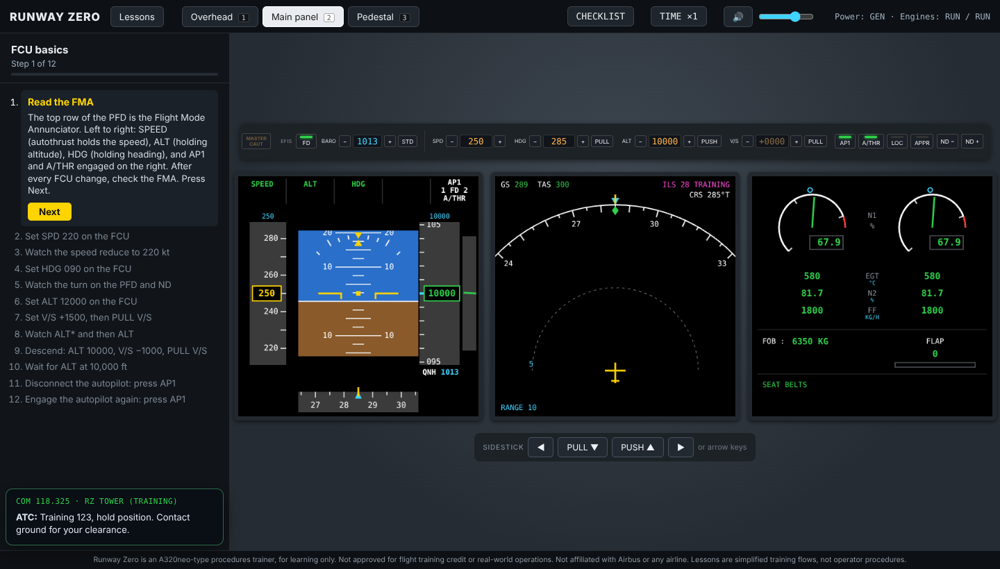</td>
    <td width="50%">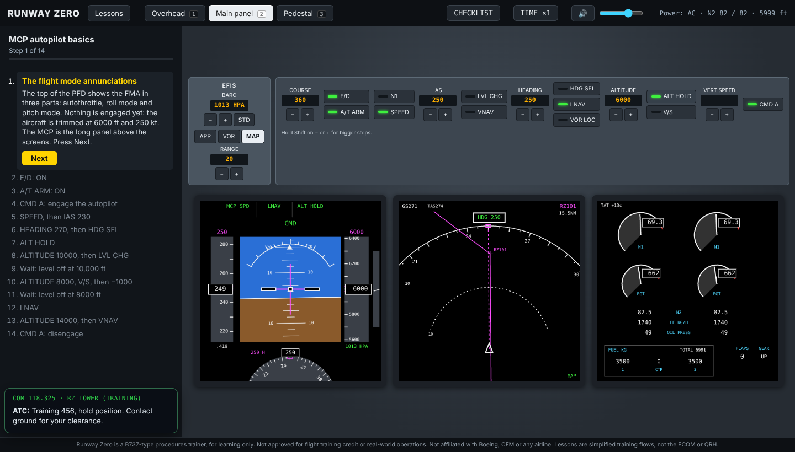</td>
  </tr>
  <tr>
    <td><b>A320neo-type</b>: overhead, FCU, PFD, ND, ECAM with system pages, MCDU, radio management panel. 11 lessons from power up to a generator fault and an engine fire.</td>
    <td><b>B737-type</b>: overhead, MCP, three large screens, CDU, start levers, radios. 7 lessons from cold and dark to LNAV, VNAV and an engine fire.</td>
  </tr>
  <tr>
    <td>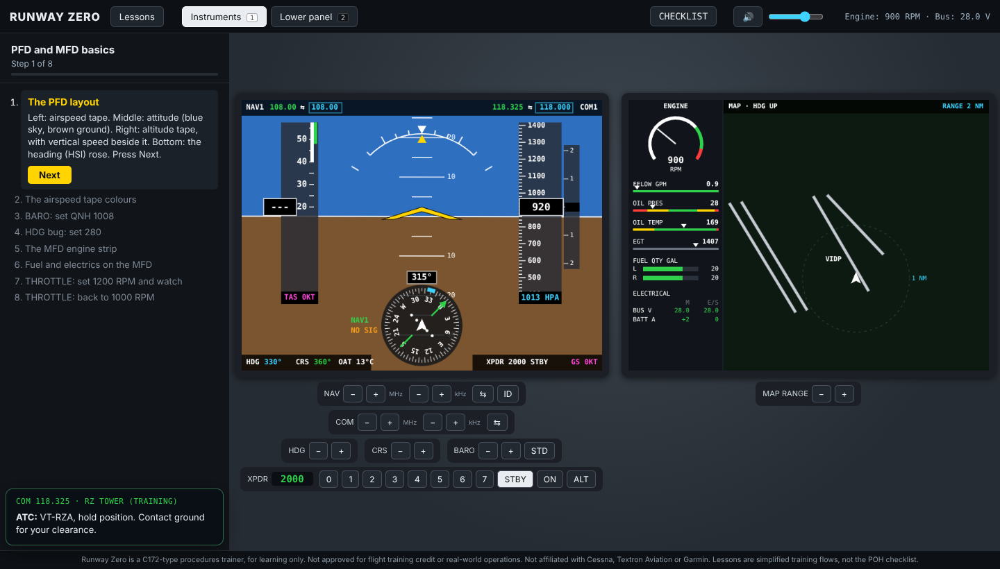</td>
    <td>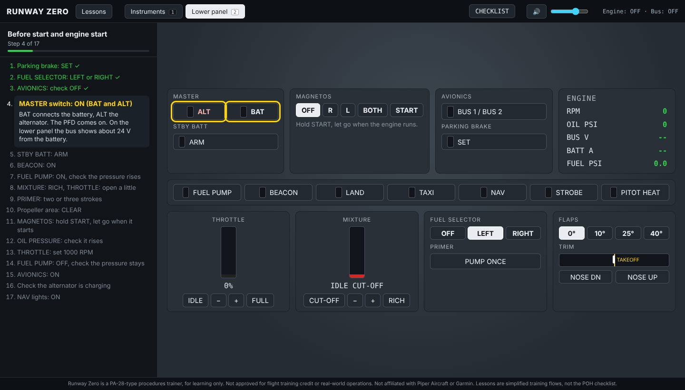</td>
  </tr>
  <tr>
    <td><b>C172-type</b>: glass PFD and MFD, magneto key, fuel selector and shutoff. 12 lessons including an engine failure after take-off, an alternator failure and a first flight you fly yourself.</td>
    <td><b>PA-28-type</b>: low wing, left and right tanks with no BOTH, hand primer, fuel pressure. 7 lessons including a fuel pump failure.</td>
  </tr>
</table>

## A closer look

<table>
  <tr>
    <td width="33%">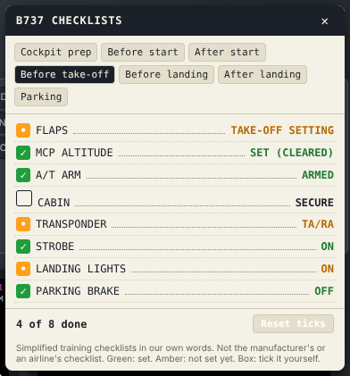</td>
    <td width="33%">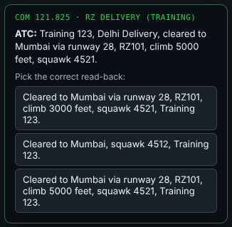</td>
    <td width="33%">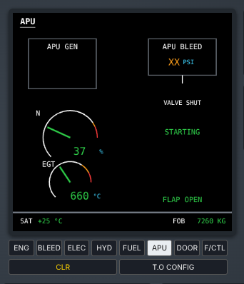</td>
  </tr>
  <tr>
    <td><b>Checklists</b>: green when set, amber when not, a box for items you tick yourself (press <kbd>C</kbd>).</td>
    <td><b>ATC clearance</b>: listen, then pick the correct read-back. A wrong one gets "negative" and a hint.</td>
    <td><b>A320 APU page</b>: opens by itself during the APU start, with N and EGT.</td>
  </tr>
  <tr>
    <td>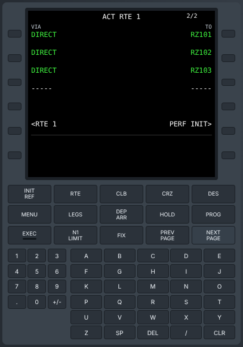</td>
    <td>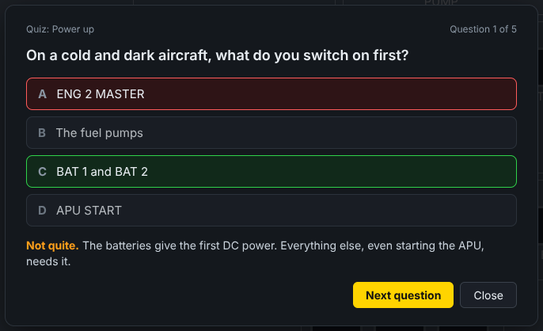</td>
    <td>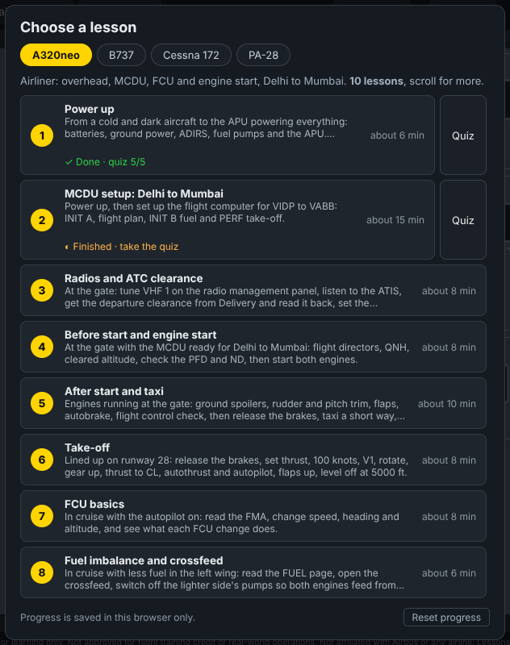</td>
  </tr>
  <tr>
    <td><b>B737 FMC</b>: POS INIT, route, ACTIVATE and EXEC, PERF INIT and take-off speeds.</td>
    <td><b>Quizzes</b>: 4 out of 5 to pass, with the reason after every answer.</td>
    <td><b>Lesson list</b>: aircraft tabs, and a tick when a lesson and its quiz are done.</td>
  </tr>
</table>

<p align="center">
  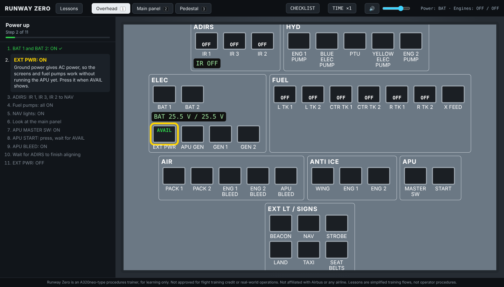
  <br><sub>The lesson guide on the left, and the A320 overhead during power up.</sub>
</p>

## Every lesson

| Aircraft | # | Lesson | What you learn |
| --- | --- | --- | --- |
| A320 | 1 | Power up | Batteries, ground power, ADIRS, fuel pumps and the APU, from cold and dark |
| A320 | 2 | MCDU setup: Delhi to Mumbai | INIT A, the flight plan with training waypoints, INIT B, PERF take-off |
| A320 | 3 | Radios and ATC clearance | VHF 1, the ATIS, a clearance with a spoken read-back, transponder, RAD NAV |
| A320 | 4 | Before start and engine start | FD, QNH, FCU altitude, V speeds, doors, beacon, both engines, APU off |
| A320 | 5 | After start and taxi | Spoilers, trims, flaps, autobrake, flight control check, T.O CONFIG |
| A320 | 6 | Take-off | Thrust, 100 knots, V1, rotate, gear up, CL, autopilot, level at 5,000 ft |
| A320 | 7 | FCU basics | Read the FMA, change speed, heading and altitude, V/S, AP on and off |
| A320 | 8 | Fuel imbalance and crossfeed | FUEL page, X FEED, pumps off on the lighter side, balance |
| A320 | 9 | ECAM: a generator fault | GEN 1 fails, MASTER CAUT, ECAM actions, CLR |
| A320 | 10 | Engine fire on the ground | ENG 1 FIRE, MASTER WARN and the repeating chime, ENG MASTER off, fire pushbutton, both bottles |
| A320 | 11 | Shutdown and secure | APU start, engines off, ground power, ADIRS off, cold and dark |
| B737 | 1 | Power up from cold and dark | Battery, IRS, APU start, APU generators, APU bleed |
| B737 | 2 | FMC route set-up | IDENT, POS INIT, RTE, ACTIVATE and EXEC, PERF INIT, TAKEOFF REF |
| B737 | 3 | Engine start | Packs off, start switch GRD, start lever IDLE at 25% N2, generators on |
| B737 | 4 | MCP autopilot basics | F/D, A/T, CMD A, SPEED, HDG SEL, ALT HOLD, LVL CHG, V/S, LNAV, VNAV |
| B737 | 5 | Radios and ATC clearance | VHF 1, the ATIS, QNH, a spoken clearance, transponder, MCP altitude |
| B737 | 6 | VOR and ILS | NAV 1, Morse ident, ND in VOR mode, radial TO and FROM, ILS in APP mode |
| B737 | 7 | Engine fire on the ground | Fire bell, FIRE WARN, start lever CUTOFF, pull the fire handle, turn it to fire both bottles |
| C172 | 1 | Before start and engine start | Fuel, master, priming with the fuel pump, the key, oil pressure, avionics |
| C172 | 2 | PFD and MFD basics | Tapes, colours, HSI, baro, heading bug, engine strip, fuel and electrics |
| C172 | 3 | Radios and ATC clearance | COM tuning, the ATIS, a clearance from Ground, transponder |
| C172 | 4 | VOR and ILS | Tune and identify a VOR, radial FROM, course TO, the localizer |
| C172 | 5 | Run-up before take-off | 1800 RPM, magneto check, engine and electrics, trim, flaps |
| C172 | 6 | First flight 1: Taxi and take-off | Keyboard flying, taxi to the holding point, line up, lift off at 55 knots, climb, trim, level off |
| C172 | 7 | First flight 2: Fly the circuit | Crosswind, downwind, before-landing check, flaps 10 abeam, base, flaps 20, final |
| C172 | 8 | First flight 3: Land | 65 knots on final, the PAPI, power to idle, flare, touch down, brake |
| C172 | 9 | Engine failure after take-off | The engine stops at 500 ft: nose down, glide at 68 knots, land ahead in a field, mixture cut-off |
| C172 | 10 | Alternator failure | LOW VOLTS, reset the alternator, shed load, plan to land |
| C172 | 11 | Fuel management and starvation | An empty tank stops the engine, switch tanks, restart |
| C172 | 12 | Shutdown and secure | Avionics off, mixture to cut-off, magnetos off, master off |
| PA-28 | 1 | Before start and engine start | Fuel selector, electric fuel pump, hand primer, the key, fuel pressure |
| PA-28 | 2 | Radios and ATC clearance | As the C172, with the callsign VT-RZP |
| PA-28 | 3 | VOR and ILS | As the C172 |
| PA-28 | 4 | Run-up before take-off | Fuller tank, fuel pump on, 2000 RPM, magneto check, carb heat |
| PA-28 | 5 | Switching fuel tanks | Fuel pump on, change tanks, check the pressure, note the time |
| PA-28 | 6 | Engine fuel pump failure | FUEL PRESS, electric pump on at once, plan to land |
| PA-28 | 7 | Shutdown and secure | Fuel pump off, mixture to cut-off, magnetos off, fuel selector OFF |

## How to use it

1. Open **[the trainer](https://www.runwayzero.in/)** in Chrome, Edge, Firefox or Safari on a desktop or laptop.
2. Pick an aircraft tab and a lesson. Click anywhere once so the browser lets the sound play.
3. Read the step on the left. The control to use pulses yellow, and the right panel opens by itself.
4. Do what the step says. It ticks off when the aircraft is really in that state.
5. At the end, take the quiz. Press <kbd>C</kbd> any time to open the checklists.
6. Not sure what something is? Press **EXPLORE** and point at it. Press <kbd>Esc</kbd> to stop exploring.

| Key | Action |
| --- | --- |
| <kbd>1</kbd> <kbd>2</kbd> <kbd>3</kbd> | Switch panels (overhead, main panel, pedestal, or instruments and lower panel on the light aircraft) |
| <kbd>L</kbd> | Lesson list |
| <kbd>C</kbd> | Checklists |
| <kbd>Esc</kbd> | Stop exploring |
| <kbd>3</kbd> | C172: the outside view |
| <kbd>M</kbd> | Sound on or off |
| Arrow keys | A320 sidestick |
| Shift + click | Bigger steps on the − and + buttons |

Flying the C172 in the first flight lessons:

| Key | Action |
| --- | --- |
| <kbd>↓</kbd> <kbd>↑</kbd> | Pull back (nose up) and push (nose down). Springs back when you let go. Shift for full travel |
| <kbd>←</kbd> <kbd>→</kbd> | Roll left and right |
| <kbd>W</kbd> <kbd>S</kbd> | More and less power (Shift+W full, Shift+S idle) |
| <kbd>A</kbd> <kbd>D</kbd> | Rudder and nose wheel steering |
| <kbd>F</kbd> <kbd>R</kbd> | Flaps down and up one stage |
| <kbd>Q</kbd> <kbd>E</kbd> | Trim nose down and nose up |
| <kbd>B</kbd> | Brakes (hold) |
| <kbd>P</kbd> | Parking brake on and off |
| <kbd>V</kbd> | Cockpit view or view from behind the aircraft |
| <kbd>G</kbd> | Guide dots and aim box on and off |
| <kbd>H</kbd> | Keys card on and off |

Long waits, like IRS alignment or a climb, have a **TIME** button in the top bar on the airliners (×1, ×4, ×8).

## FAQ

**Is it free?**
Yes. It is open source under the GPL v3 and runs in your browser. There are no accounts, ads or payments.

**Can I log hours or use it for my licence?**
No. It is a learning aid for procedures, not an approved training device.

**Is it a full flight simulator?**
Not yet. It is a procedures trainer, so there is no outside view. Under the panels there is a real flight model (JSBSim), so the aircraft does move, climb and turn. Flying by hand comes later.

**Are the checklists and lessons the real ones?**
No. They are simplified flows in our own words, from general public knowledge. Always use your airline's or school's documents for real flying.

**Does it work on a phone?**
Yes for the procedure lessons, checklists, quizzes and the glossary. On a phone the cockpit sits above the lesson (or beside it in landscape), panels stay big enough to tap and scroll with a finger, and each step scrolls its switch into view. The first flight lessons still need a keyboard.

**Does Speak record my voice?**
No. Runway Zero does not record or keep anything. The browser turns your speech into text with its own online service (Google in Chrome, Microsoft in Edge), and only the text is checked, on your computer. If you would rather not use the microphone, pick the read-back instead.

**Are the frequencies and waypoints real?**
No. All radio frequencies, navaids and waypoints are made up for training and labelled TRAINING or RZ. Never use them for real flight.

**I can't hear anything.**
Browsers only allow sound after your first click or key press. Check the speaker button in the top bar is on. The spoken ATC uses your computer's own voices, so the voice depends on your browser and system.

**Does it work on a phone?**
It is made for a desktop or laptop screen with a mouse. A tablet may work, but the panels are small.

**Where is my progress saved?**
In your browser only. Clearing your browser data, or using another browser, starts fresh. The lesson list has a Reset progress button.

## Contributing

You don't need to write code to help.

- **Pilots and instructors**: try a lesson or a checklist and tell us what is wrong or missing. Type-rated pilots for the A320 and B737, and flight instructors for the C172 and PA-28, are especially welcome.
- **Learners**: tell us what was confusing, or which lesson you would like next.
- **Developers**: bug fixes, new lessons, new panels and better sounds are all welcome.

Open an [issue](https://github.com/abhinavch07/runway-zero/issues) with what you found. For code, fork the repository, make your change on a branch, run `npm run typecheck`, and open a pull request.

---

## For developers

### Run it

You need Node.js 20 or newer.

```bash
npm install
npm run dev               # open the address it prints, usually http://localhost:5173
```

No accounts, tokens or keys are needed.

```bash
npm run build         # production build in dist/
npm run preview       # serve the production build
npm run typecheck     # TypeScript check
npm run test:fdm      # run the flight model for 60 s in Node
npm run test:c172     # C172 start-up, run-up and shutdown in Node
npm run test:readback  # the spoken read-back checker with typical speech-to-text output
npm run test:firstflight  # a robot pilot flies the three C172 first flight lessons with the real lesson checks
npm run test:pa28     # PA-28 primer start, run-up, take-off and climb in Node (add "pump" or "dry" for the failures)
npm run test:737      # B737 power up, engine start and every autopilot mode in Node
npm run test:flights  # scripted test flights: cold start and taxi, ground, normal law, takeoff, ILS and landing
```

### Publishing

The site is the built `dist/` folder on the `gh-pages` branch, served at [www.runwayzero.in](https://www.runwayzero.in/). To publish the latest `main`, run `npm run publish:pages`. GitHub Pages is set to Deploy from a branch: `gh-pages`, `/ (root)`. The custom domain comes from `public/CNAME`, which is copied into every build, so publishing never loses it.

### How it is built

`index.html` is the welcome page (`src/welcome/`): the runway hero, the aircraft, suggested learning paths and how a lesson works. Each aircraft has its own page: `a320.html`, `737.html`, `c172.html` and `pa28.html` (the light aircraft share one script). `glossary.html` lists every glossary word with a search box. Old links like `/?lesson=powerup` are sent on to `a320.html`. The "Runway Zero" name in each trainer's top bar goes back to the welcome page. The flight model runs in a Web Worker at 120 Hz. The page draws the panels and screens, runs the lessons and plays the sound.

```
src/
  welcome/              the welcome page (fonts: Barlow and Barlow Condensed, self-hosted)
  main.ts               A320 page, panels, lesson picker, display loop
  config.ts             A320 start positions
  lessons/              lessons.ts (A320), quizzes.ts (every aircraft), catalog.ts, progress.ts
  shell/picker.ts       lesson list with aircraft tabs, shared by every page
  shell/checklist.ts    checklist panel, shared by every page
  shell/explore.ts      explore mode (cards for every control), with the cards in explore/
  glossary/             terms.ts (the words), glossary.ts (underlines and pop-ups), page.ts (glossary.html)
  checklists/           a320.ts, b737.ts, ga.ts (C172 and PA-28)
  sim/                  A320: worker, JSBSim core, normal law and autopilot (fcc.ts), systems, ILS
  cockpit/              A320: PFD, ND, engine and warning display, ECAM pages, FCU, EFIS, MCDU,
                        radio panel, overhead, pedestal levers, and the shared lesson panel and quiz
  b737/                 B737: page, worker, systems, autopilot (sim/afcs.ts), PFD, ND, engine display,
                        overhead, MCP, pedestal, CDU (cockpit/cdu.ts), lessons
  c172/                 light aircraft: page, worker, systems, PFD, MFD, lower panel, lessons,
                        and the first flight: world.ts (runway frame, circuit), cockpit/outside.ts
                        (the 3D view and the aircraft, drawn on a 2D canvas), cockpit/miniPfd.ts,
                        flightKeys.ts, firstFlight.ts
                        (sim/variant.ts holds what differs between the C172 and the PA-28)
  radio/                training frequencies, the NAV receiver, the radio box, spoken ATC (voice.ts)
  audio/                sound.ts (hum, APU, engines, clicks, chimes), extras.ts (systems, starts, alerts)
  world/                VIDP runway data, the training ILS 28, geo helpers, the training waypoints
public/jsbsim/          JSBSim aircraft and engine files
scripts/                Node test scripts
docs/images/            the pictures in this README
public/img/             pictures on the welcome page, and the share image for link previews
```

### Writing a Ground School module

Modules live in `src/ground/<subject>/` as plain data (notes blocks, slides, questions) and are listed in `src/ground/subjects.ts`. Diagrams are SVG built in `src/ground/figures.ts`. Run `npm run test:ground` to check every question has four options and a valid answer, and that the text keeps the house style. The mock exam pattern is set once in `MOCK` in `subjects.ts`.

### Writing a lesson

Each lesson has a start position and a list of steps. A step has a title, a short "why", the controls to highlight (their `data-ctl` names), the panel to show, and a `done(state, controls, extra)` check. Steps without a `done` check wait for the learner to press Next. Use `want: true` or `want: false` on switch steps so switches already in place stop pulsing. Add 5 quiz questions for the lesson in `src/lessons/quizzes.ts`.

### What is simplified

- **A320**: the flight model is JSBSim's public A320 with CFM56 engines, not LEAP. EGT is an approximation. Hydraulics, packs and anti-ice are on/off models. The only failure is GEN 1. All FCU values are selected, and the MCDU flight plan is not flown yet. Headings are true, not magnetic.
- **B737**: JSBSim's public 737 with CFM56 engines. CMD A with no mode holds attitude and wings level (CWS). VNAV only climbs, at 250 kt below 10,000 ft and 280 kt above. Take-off speeds come from a simple made-up rule. The screens, MCP and CDU are our own drawings in the general style of the newer large-screen cockpits.
- **C172 and PA-28**: the glass PFD and MFD are our own drawings in the general style of light aircraft glass cockpits. The PA-28 model is changed to two tanks, a fixed-pitch propeller and 0, 10, 25 and 40 degree flaps.
- **First flight**: the world is flat ground at the runway 28 threshold height, with made-up fields, one taxiway and no other airport buildings, traffic or wind. The circuit is our own left-hand training pattern about 0.8 NM from the runway, not a published one. Headings are true. A flight instructor should review these lessons.
- **Everywhere**: IRS and ADIRS alignment takes 60 seconds, not several minutes. Sounds are made up in the browser, not recordings.

### Training radio and navigation data

RZ ATIS 126.025, RZ DELIVERY 121.825, RZ GROUND 121.775, RZ TOWER 118.325, the RZV VOR on 113.35 (18 NM north-west of Delhi) and the IRZ ILS 28 on 110.55. The RZ101, RZ102 and RZ103 waypoints lie between Delhi and Mumbai. All made up for training.

### Data sources

- Lessons, checklists, quiz questions, explore cards and the glossary are our own simplified training flows, written from general public knowledge. A type-rated pilot (or a flight instructor for the light aircraft) should review them.
- VIDP runway ends, headings and elevations: [OurAirports](https://github.com/davidmegginson/ourairports-data) (public domain).
- The MCDU and CDU are small training versions, not copies of the real software. VABB is listed by runway ident only. ILS 28 is built from the runway geometry, a training stand-in, not the published procedure.

### Licences

- Runway Zero code: GPL v3 or later (see `LICENSE`).
- JSBSim and its A320 and engine data files: LGPL 2.1 (`public/jsbsim/COPYING-LGPL-2.1.txt`). The A320 model notes it is built from public data, for educational and entertainment use, and not to be sold. Our copy is modified: fuel tank position moved from 600 to 650 in, CmDe changed from -1.5 to -2.0 so the model can be trimmed at normal approach speeds, and nose gear steering widened from 5° to 70° for taxiing. The changes are noted at the top of `A320.xml`.
- JSBSim Cessna 172 (`aircraft/c172p`, `engine/eng_io320.xml`, `engine/prop_75in2f.xml`): LGPL 2.1, unmodified.
- JSBSim 737 (`aircraft/737`, `engine/CFM56.xml`): the model file states the GPL. Our copy only removes the telnet and socket inputs, and the change is noted in its header.
- JSBSim PA-28-180 (`aircraft/pa28`, `engine/engIO360C.xml`): LGPL 2.1. The aircraft file is modified (two tanks, fixed-pitch propeller, main wheel steering off, 10° first flap stage), and the changes are noted in its header.
- Each JSBSim model notes it is built from public data, for educational and entertainment use, and not to be sold.
- JSBSim WebAssembly build: `@0x62/jsbsim-wasm`, MIT.
- Barlow and Barlow Condensed fonts: SIL Open Font License 1.1, through `@fontsource`.

<p align="center"><sub>Clear skies. ✈️</sub></p>
